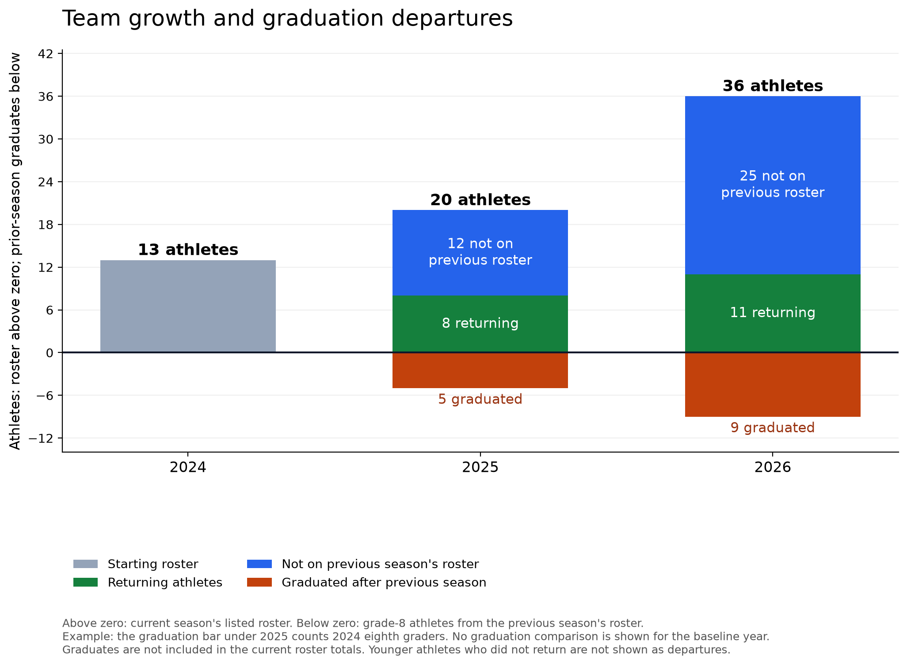
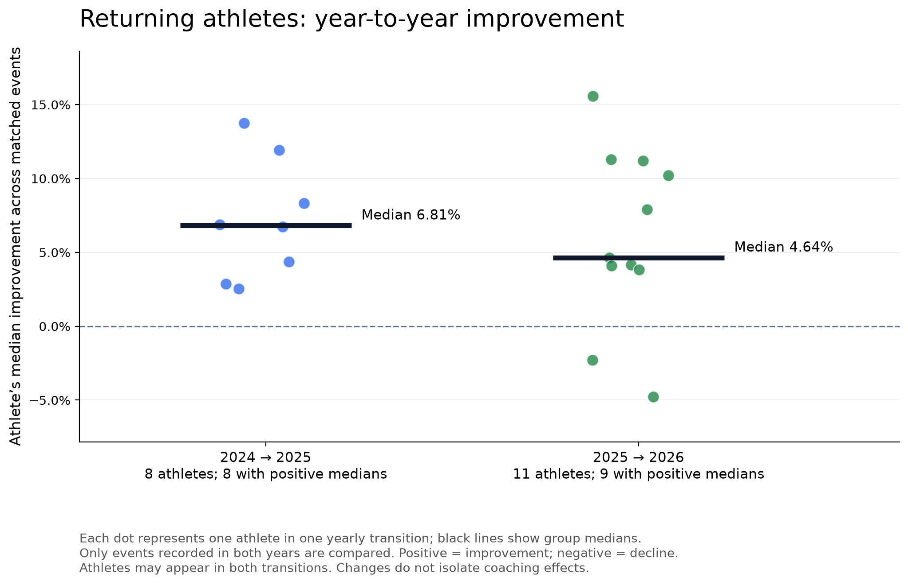
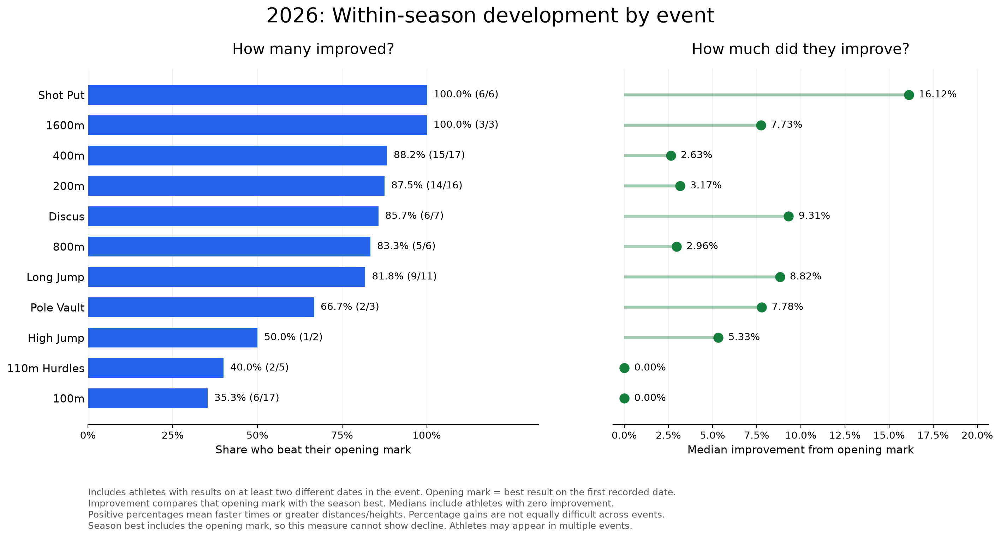
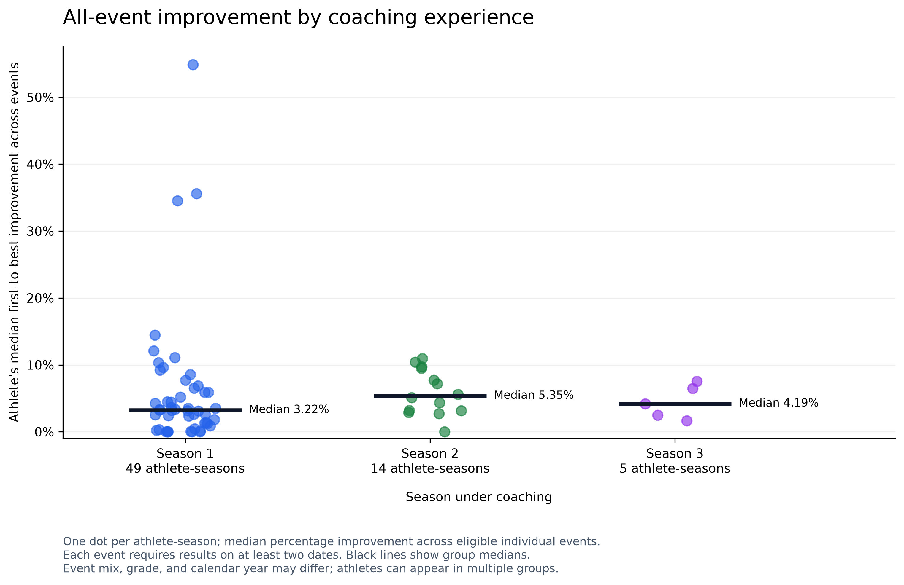
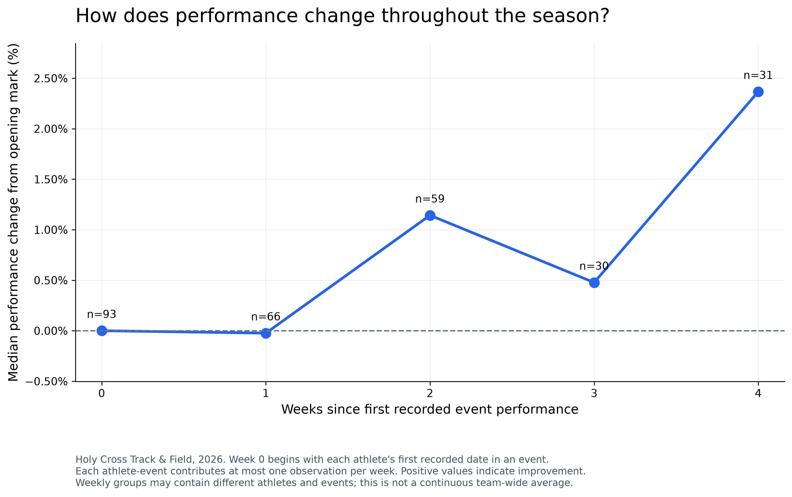
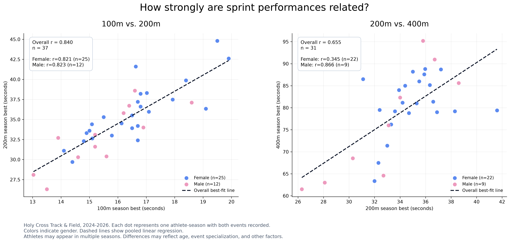
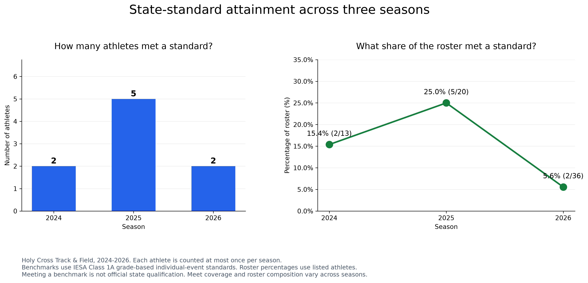
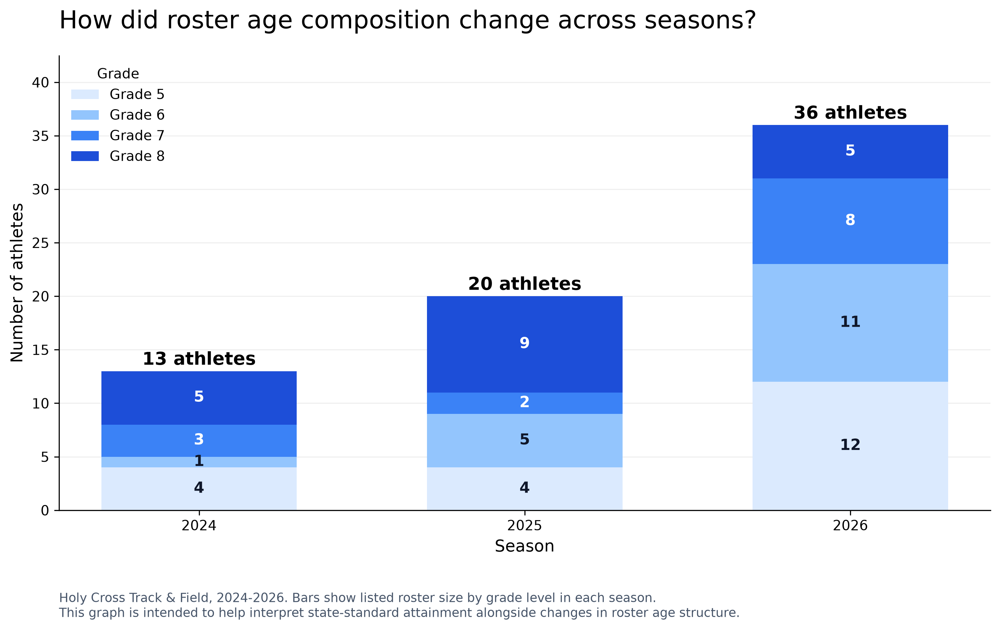

# Holy Cross Track & Field: A Three-Year Performance Analysis (2024–2026)

## Introduction

In 2024, I became the head coach of the Holy Cross Grade School track and field program in Mendota, Illinois. At the time, Holy Cross was just one day away from canceling its track and field season because of lack of participation and no coach. I accepted the position immediately. Having competed in track and field throughout my life, I wanted to give these students the same opportunity to experience the sport that I had growing up.

Over the next three seasons, I had the opportunity to help rebuild and grow the program while working with athletes of different ages, abilities, and experience levels.

As a mathematics student with an interest in data analytics, I wanted to take a closer look at that development. Rather than relying entirely on meet placements, personal records, or my own observations as a coach, I wanted to see what the raw numbers could tell me.

That idea eventually became this project: an analysis of **869 individual track and field performances** recorded between 2024 and 2026. Using Python, pandas, Matplotlib, and Excel, I combined athlete-level results, meet dates, grade levels, coaching experience, and event-specific performance standards to investigate trends in participation and athletic development.

The central question behind this project is: **How can performance data be used to evaluate the development of a growing grade school track and field program?**

To answer this question, this project addresses four primary questions:

1. **Program Growth:** How did roster size, retention, and grade composition change between 2024 and 2026?
2. **Athlete Development:** How much did athletes improve within seasons and across consecutive years, and how did improvement vary by event, grade, and coaching experience?
3. **Performance Relationships:** How strongly were results in related track events associated, and what patterns emerged from exploratory correlation analyses?
4. **State Benchmark Attainment:** How did the proportion of athletes meeting grade-based Class 1A performance standards change, and how might roster composition help explain those differences?

Through statistical summaries, comparisons, and data visualizations, the goal is to provide an evidence-based assessment of the program's development while identifying opportunities for future improvement.

## 1. Program Growth and Participation

Between 2024 and 2026, the Holy Cross track and field program experienced substantial growth in athlete participation. The recorded roster expanded from **13 athletes in 2024 to 20 in 2025 and 36 in 2026**, representing an overall increase of approximately **177%**.

This expansion occurred despite the annual graduation of eighth-grade athletes, requiring the program to continuously recruit and develop new participants.

### Athlete Retention and Recruitment

Roster growth reflects two important components of program development: retaining returning athletes and welcoming new participants.

The analysis tracks athletes across consecutive seasons using unique athlete identifiers, allowing returning participants to be distinguished from athletes who were not listed on the previous season's roster.

The visualization also separates eighth-grade graduates from current roster counts, providing context for how the program continued expanding while older athletes transitioned out of middle school.

These findings establish the foundation for the remainder of the analysis. As participation increased, the program gained opportunities to develop more athletes, but its changing roster composition also became an important consideration when comparing performances across seasons.

## 2. Athlete Development and Improvement

Beyond participation growth, a primary objective of this project was to evaluate how individual athletes developed throughout their time in the Holy Cross track and field program.

Athlete improvement was analyzed from two perspectives: **year-to-year development**, comparing season-best performances across consecutive years, and **within-season development**, comparing an athlete's first recorded performance in an event with their best result from that season.

For running events, improvement was measured through reductions in recorded times. For field events, improvement was measured through increases in distance or height. Percentage changes were used to compare progress across different events, although the practical meaning of a percentage improvement varies by event.

### 2.1 Year-to-Year Improvement Among Returning Athletes

To evaluate longer-term development, season-best performances were compared for returning athletes who competed in the same event in consecutive seasons.

For each athlete, percentage improvements were calculated across matching events and summarized using the median. This prevented athletes competing in more events from receiving disproportionate weight in the analysis.

The results showed positive median improvement for the majority of returning athletes:

- **2024–2025:** All 8 returning athletes included in the matched-event analysis recorded positive median improvement, with a group median of **6.81%**.
- **2025–2026:** 9 of 11 returning athletes recorded positive median improvement, with a group median of **4.64%**.

These findings suggest that most returning athletes achieved stronger season-best performances as they progressed through the program.

However, improvement was not universal. Some athletes recorded lower performances in subsequent seasons, demonstrating why individual comparisons are necessary rather than assuming development occurs uniformly.

### 2.2 Within-Season Improvement by Event

In addition to year-to-year comparisons, athlete development was evaluated within individual seasons.

For each athlete-event combination with results on at least two different dates, the first recorded performance was compared with the season-best mark.

The 2026 season was selected for detailed event-level analysis because it contained the largest number of recorded performances.

The analysis revealed considerable variation between events.

**Shot put demonstrated particularly strong improvement**, with all 6 eligible athletes improving beyond their opening marks and a median improvement of **16.12%**.

The 400m also showed a high frequency of improvement, with **15 of 17 eligible athletes (88.2%)** recording faster season-best times than their opening performances.

By comparison, only **6 of 17 athletes (35.3%)** improved their opening 100m performances, with a median improvement of 0%.

These differences identify areas where recorded performance development was especially strong, alongside events that may warrant further attention.

However, event comparisons must be interpreted carefully. Technical field events may offer greater opportunities for large percentage improvements as athletes learn proper technique, while small improvements in sprint times can still represent meaningful athletic progress.

### 2.3 Improvement by Coaching Experience

To investigate whether improvement patterns differed with time spent in the program, athletes were grouped according to the number of seasons they had participated under the current coaching structure.

Each athlete-season was represented by their median within-season improvement across eligible individual events.

The median improvements were:

- **First-season athletes:** 3.22% across 49 athlete-season observations.
- **Second-season athletes:** 5.35% across 14 athlete-season observations.
- **Third-season athletes:** 4.19% across 5 athlete-season observations.

Second-season athletes recorded the highest median improvement, although the difference was not consistent across all experience levels.

These findings suggest that development patterns may vary with program experience. However, the groups differed in size, age, event participation, and calendar year. The results therefore do not establish that additional seasons of coaching directly caused greater improvement.

### 2.4 Performance Progression Throughout the Season

A separate analysis examined when performance changes occurred during the 2026 season.

For each eligible athlete-event combination, recorded performances were compared with the opening mark and grouped by the number of weeks elapsed since the athlete's first recorded competition in that event.

The resulting trend showed fluctuating but generally positive performance changes as the season progressed.

By Week 4, the median recorded improvement was approximately **2.37%** relative to opening performances, based on 31 athlete-event observations.

This suggests that athletes represented in later weeks were generally performing above their initial recorded levels.

However, weekly observations did not represent an identical group of athletes and events. Changes in participation, event selection, and competition opportunities may have influenced the trend. Week 5 was excluded from the visualization because only two eligible observations were available.

### 2.5 Summary of Athlete Development

Across the analyses, several patterns emerged:

- Most returning athletes improved their season-best performances between consecutive years.
- Within-season improvement varied considerably across events.
- Athletes with different levels of coaching experience demonstrated different improvement distributions.
- Performance generally improved relative to opening marks over the recorded season, although individual trajectories varied.

Taken together, these results demonstrate substantial recorded athlete development while also identifying areas where improvement was less consistent.

The findings provide a foundation for evaluating training priorities, event-specific development, and future opportunities for athlete progression.

## 3. Performance Relationships and Correlation Analysis

Beyond measuring individual improvement, this project explored relationships between performances in different track events.

Using athlete season-best times, Pearson correlation coefficients and linear regression were used to examine whether performance in one sprint event was associated with performance in another.

### 3.1 Relationships Between Sprint Events

Two comparisons were conducted:

- **100m vs. 200m:** Investigating the relationship between short-distance sprint performances.
- **200m vs. 400m:** Examining whether shorter-distance sprint performance was similarly associated with performance over a longer distance.

Each observation represented an athlete-season with recorded season-best times in both events. Athletes were grouped by gender to examine potential differences in these relationships.

The analysis revealed two notable findings:

**100m and 200m performances demonstrated a strong positive correlation (r = 0.840, n = 37).** Athletes with faster 100m season-best times generally recorded faster 200m times.

**200m and 400m performances showed a weaker positive correlation (r = 0.655, n = 31).** Although faster 200m athletes generally performed better in the 400m, results varied more considerably.

One possible explanation is that the 400m places greater demands on sustained speed and endurance than the 100m or 200m. However, the dataset cannot establish that this difference caused the weaker correlation.

### 3.2 Differences Between Gender Groups

When correlations were calculated separately by gender, additional patterns emerged.

For the 100m and 200m, both boys and girls demonstrated similarly strong positive relationships.

The 200m and 400m comparison showed greater variation between groups, with the boys' results exhibiting a stronger linear relationship than the girls' results.

Because subgroup sample sizes were relatively small, particularly among boys, these differences should be interpreted cautiously.

Furthermore, athletes may appear in multiple seasons, and differences in age, athletic development, and event specialization may influence the observed relationships.

### 3.3 Interpretation and Applications

These findings demonstrate how correlation analysis can help identify relationships between related athletic events.

Such comparisons may offer useful context when considering potential event specialization or identifying athletes whose performances differ from expected patterns.

However, correlation does not establish causation, and strong relationships do not guarantee accurate predictions for individual athletes.

The results are therefore best interpreted as exploratory evidence rather than definitive measures of athlete potential.

## 4. State Benchmark Analysis

An important objective of this project was to evaluate how Holy Cross athletes performed relative to Illinois Elementary School Association (IESA) Class 1A state qualifying standards.

Each recorded individual performance was compared with the applicable season-, gender-, division-, and event-specific benchmark. Athletes in grades 5–7 were compared with seventh-grade division standards, while eighth graders were compared with eighth-grade division standards.

An athlete was counted as meeting a benchmark if at least one recorded individual performance met or exceeded the applicable standard during the season.

These comparisons measure performance relative to published benchmarks, not official state qualification.

### 4.1 State-Standard Attainment Across Seasons

The proportion of athletes meeting at least one benchmark varied substantially between 2024 and 2026.

| Season | Athletes Meeting a Benchmark | Percentage of Roster |
|---|---|---|
| 2024 | 2 of 13 | 15.4% |
| 2025 | 5 of 20 | 25.0% |
| 2026 | 2 of 36 | 5.6% |

Benchmark attainment peaked in 2025, when one-quarter of the recorded roster achieved at least one performance meeting a Class 1A benchmark.

In 2026, the number of athletes meeting a benchmark decreased from five to two, despite substantial roster growth.

Rather than interpreting this decline as evidence of reduced program effectiveness, additional analysis was conducted to examine whether changes in athlete demographics and roster composition could help explain the results.

### 4.2 Changes in Roster Composition

The program experienced a substantial shift toward younger athletes during the three-year period.

| Season | Grades 5–6 | Grades 7–8 | Younger Share of Roster |
|---|---|---|---|
| 2024 | 5 | 8 | 38.5% |
| 2025 | 9 | 11 | 45.0% |
| 2026 | 23 | 13 | 63.9% |

By 2026, nearly two-thirds of the roster consisted of fifth- and sixth-grade athletes, compared with 45.0% in 2025.

This shift is relevant because younger athletes may have less physical development and competitive experience than older athletes, even when assessed against the seventh-grade division benchmark.

The younger roster provides a plausible partial explanation for the decline in overall benchmark attainment, but it does not establish causation.

### 4.3 Benchmark Attainment by Grade Group

To investigate whether roster composition fully explained the decline, athletes were divided into two groups: grades 5–6 and grades 7–8.

| Season | Grades 5–6 Meeting Benchmark | Grades 7–8 Meeting Benchmark |
|---|---|---|
| 2024 | 0 of 5 (0.0%) | 2 of 8 (25.0%) |
| 2025 | 0 of 9 (0.0%) | 5 of 11 (45.5%) |
| 2026 | 0 of 23 (0.0%) | 2 of 13 (15.4%) |

Across all three seasons, no fifth- or sixth-grade athlete recorded an individual performance meeting the applicable benchmark.

Consequently, the substantial increase in younger athletes reduced the overall roster percentage meeting a state standard.

However, an additional finding emerged: **benchmark attainment among seventh- and eighth-grade athletes also declined**, from 45.5% in 2025 to 15.4% in 2026.

This indicates that the changing age composition alone cannot fully explain the overall decline.

Differences in athlete experience, graduating classes, event participation, and individual performance levels may also have contributed.

### 4.4 Interpretation and Coaching Applications

The results highlight the importance of considering roster composition when comparing team-level outcomes across seasons.

A growing program may experience lower benchmark attainment percentages while simultaneously expanding participation and developing younger athletes.

For future seasons, tracking benchmark attainment alongside grade distribution could help distinguish between changes in participation and changes in competitive performance.

The analysis also suggests value in monitoring athletes approaching state benchmarks, particularly among returning seventh- and eighth-grade competitors.

Ultimately, the 2026 decline should be interpreted within the broader context of program growth, roster turnover, and athlete development rather than as a standalone measure of coaching success.

## 5. Conclusions and Coaching Applications

This project analyzed 869 individual track and field performances from the 2024–2026 Holy Cross seasons to evaluate participation growth, athlete development, performance relationships, and state-level benchmark attainment.

The findings demonstrate substantial program growth and measurable athletic improvement, while also highlighting the importance of considering roster composition, sample size, and differences between events when interpreting results.

### 5.1 Key Findings

**Program Growth**

Holy Cross's recorded roster expanded from 13 athletes in 2024 to 36 in 2026, an increase of approximately 177%. This growth occurred alongside the annual graduation of eighth-grade athletes and a substantial increase in younger participants.

**Year-to-Year Athlete Development**

Most returning athletes improved their season-best performances in events they competed in across consecutive seasons.

All eight athletes included in the 2024–2025 matched-event analysis recorded positive median improvement, compared with nine of eleven athletes in 2025–2026. These findings suggest that athletic progress continued across multiple seasons for most returning competitors.

**Differences in Event Development**

Within-season improvement varied significantly by event.

Shot put demonstrated a high median improvement percentage, while the 400m showed a particularly high proportion of athletes improving their opening performances. Other events, including the 100m, exhibited less frequent improvement.

These differences suggest that event-specific development should be evaluated using multiple measures rather than relying on a single overall improvement rate.

**Relationships Between Sprint Performances**

Correlation analysis identified a strong positive relationship between 100m and 200m season-best times (r = 0.840), while the relationship between 200m and 400m performances was weaker (r = 0.655).

These findings illustrate the usefulness of statistical analysis for exploring relationships between athletic events, although correlation alone cannot establish causation or determine an athlete's ideal event.

**State Benchmark Attainment and Roster Composition**

The percentage of athletes meeting at least one IESA Class 1A performance benchmark declined from 25.0% in 2025 to 5.6% in 2026.

During the same period, the proportion of fifth- and sixth-grade athletes increased from 45.0% to 63.9%.

The younger roster helps contextualize the decline, particularly because no fifth- or sixth-grade athletes met a benchmark during the analyzed seasons. However, benchmark attainment also decreased among seventh- and eighth-grade athletes, indicating that roster composition alone does not fully explain the change.

### 5.2 Coaching Applications

The analysis suggests several opportunities to incorporate performance data into future coaching decisions.

**1. Monitor Individual Progress Throughout the Season**

Recording athlete performances consistently across meets would allow coaches to identify improvement trends, recognize performance plateaus, and evaluate progress beyond final season-best results.

Comparing athletes with their own previous performances may provide a more meaningful measure of development than relying exclusively on placements or team-level results.

**2. Use Event-Specific Development Metrics**

Different events demonstrate different patterns of improvement.

Coaches could use event-level summaries to identify areas of strong development and events where athletes may benefit from additional technical instruction, individualized training, or adjustments to practice priorities.

These comparisons should account for the differences between running and field events, particularly when evaluating percentage improvements.

**3. Identify Athletes Approaching State Benchmarks**

Comparing season-best performances against grade-specific benchmarks can help identify athletes who are approaching competitive standards.

This information could support goal setting and event selection while giving athletes measurable performance targets throughout the season.

**4. Account for Roster Composition When Evaluating Team Performance**

Because participation and age distribution changed considerably across the three seasons, team-level outcomes should be interpreted alongside grade, experience, and roster size.

Future evaluations could compare athletes within similar grade levels and experience groups to better distinguish individual development from broader changes in team composition.

### 5.3 Limitations

Several limitations should be considered when interpreting the findings.

- **Observational data:** The analysis identifies relationships and performance trends but cannot establish that coaching decisions directly caused particular outcomes.
- **Uneven data coverage:** The number of recorded performances varied substantially between seasons, potentially affecting comparisons.
- **Small subgroup samples:** Some event, grade, and coaching-experience groups contained relatively few athletes, limiting the reliability of conclusions.
- **Differences between events:** Percentage improvement has different practical meanings across running, jumping, and throwing events.
- **Season-best comparisons:** Within-season first-to-best improvement cannot be negative because the season best includes the opening performance. This measure captures peak progress rather than consistency or end-of-season performance.
- **Roster changes:** Athlete turnover, graduation, grade distribution, and varying competition opportunities may influence year-to-year comparisons.
- **Individual events only:** Relay results were excluded from the statistical analysis.
- **Benchmark comparisons:** Meeting a performance benchmark does not necessarily represent official qualification for the IESA state championships.

These limitations reinforce the importance of interpreting statistical findings within the context of the underlying athletic program.

### 5.4 Final Takeaway

The analysis demonstrates how relatively straightforward athletic performance records can be transformed into useful insights through data cleaning, statistical analysis, and visualization.

Across three seasons, Holy Cross experienced substantial participation growth while most returning athletes demonstrated measurable year-to-year improvement in matched events.

At the same time, differences in event development, coaching experience, and roster composition revealed that evaluating an athletic program requires more than examining overall results or state-standard attainment alone.

By combining individual performance trends with broader team-level analysis, this project establishes a foundation for more informed coaching decisions and continued performance tracking in future seasons.